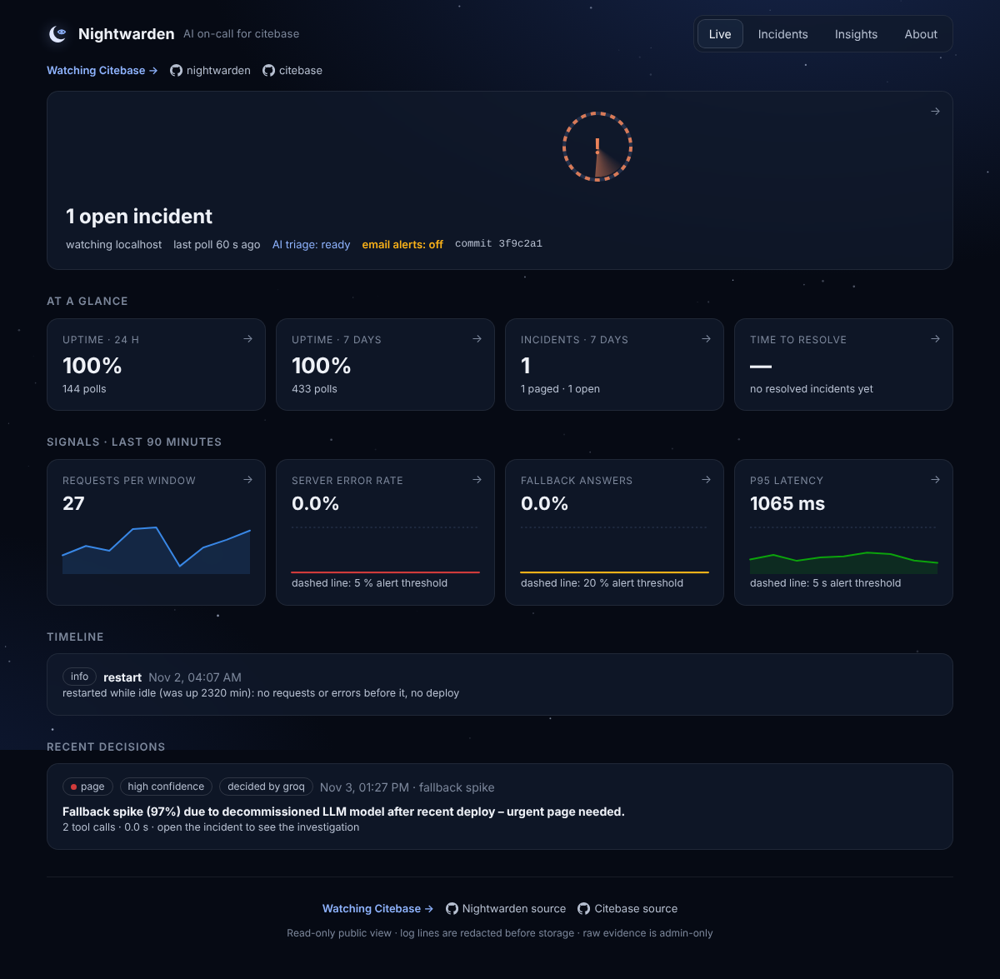
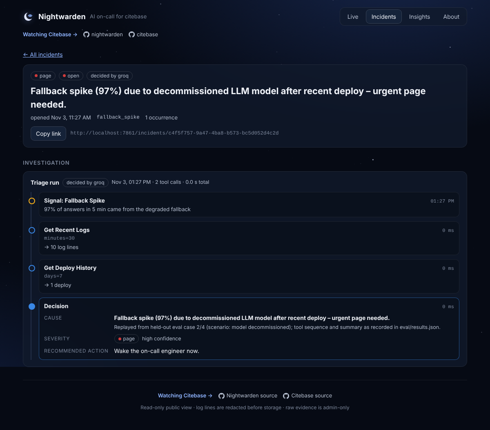
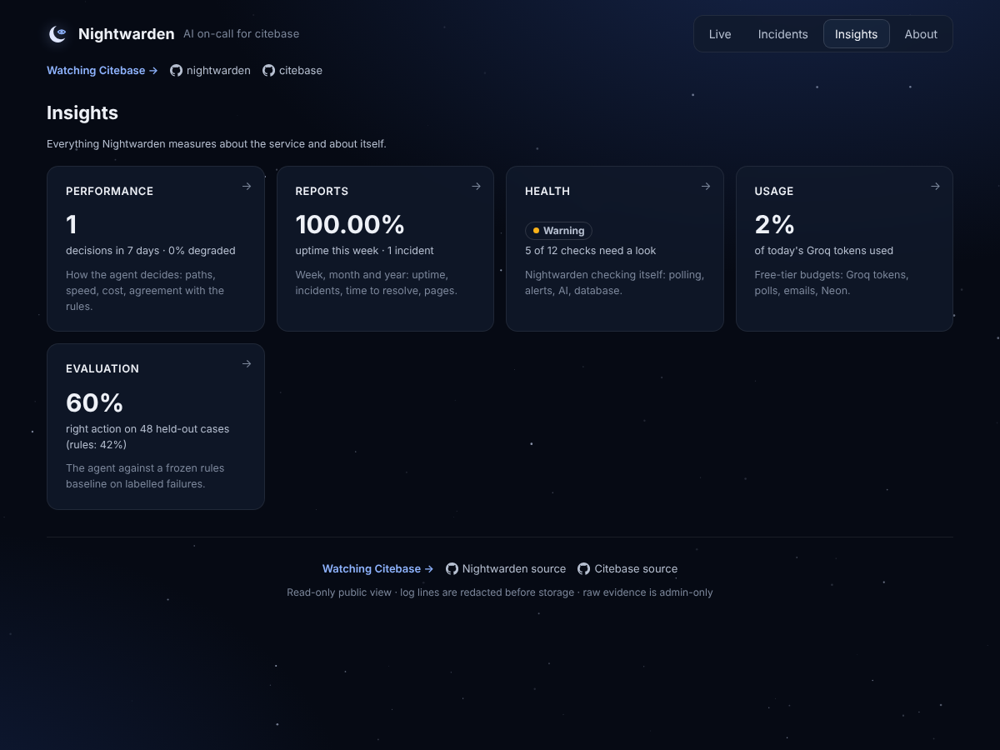

# Nightwarden

**An AI SRE agent that catches silent LLM failures: HTTP 200, 0% errors, wrong answers.**

Live: **[nightwarden-swart.vercel.app](https://nightwarden-swart.vercel.app)** (read-only public view), watching
[Citebase](https://documind-beta-lac.vercel.app), my multi-tenant RAG app.

When something looks wrong, Nightwarden investigates with read-only tools and decides what a human should do:
**page**, **notify**, **watch** or **suppress**. Every decision shows the evidence it gathered and why.

It exists because of a real outage. Citebase's LLM provider retired the model it used, the exception was swallowed,
and the app served polite fallback answers for two days. Uptime was 100%, error rate 0%, and every answer was useless.
Ordinary monitoring can't see that kind of failure. Nightwarden is built to.

| Live | Incident trace | Insights |
|---|---|---|
| [](docs/img/live.png) | [](docs/img/incident-trace.png) | [](docs/img/insights.png) |

<sub>Screenshots: a local instance at 1200 px with three days of simulated polls. The incident replays held-out
eval case 2/4 (model decommissioned): its tool sequence and summary as recorded in `eval/results.json`.</sub>

## Results

60 labelled cases: 12 failure scenarios × 5 seeded variations, replayed from fixtures (no live traffic). The
expected actions (`harness/labels.yaml`) and the rules baseline (`app/agent/baseline.py`) were written and frozen
**before** the agent existed, so neither could be tuned to make the agent look good.

**Held-out: agent vs frozen rules** (variations 1–4: 48 cases never looked at before the run; `openai/gpt-oss-120b`;
from `eval/results.json`, both columns scored on the same 48 cases):

| Metric | Frozen rules | Agent |
|---|---|---|
| Action accuracy | 41.7% (20/48) | **60.4%** (29/48) |
| Page recall (real emergencies paged) | 20.0% (4/20) | **95.0%** (19/20) |
| Page precision (pages that were real) | 100.0% (4/4) | 82.6% (19/23) |
| Silent-degradation recall | 0.0% | **75.0%** |
| Accuracy on loud failures | 55.6% | 55.6% |
| Median tool calls · mean tokens / event | — | 4 · 6,409 |
| p95 decision time | ~0 s | 39.5 s (includes free-tier rate-limit waits) |

**Per scenario** (correct of 4 held-out variations):

| # | Scenario | Expected | Rules | Agent |
|---|---|---|---|---|
| 1 | invalid API key | page | 0/4 | 4/4 |
| 2 | model decommissioned | page | 0/4 | 4/4 |
| 3 | LLM timeout | notify | 4/4 | 4/4 |
| 4 | vector store emptied *(silent)* | page | 0/4 | 4/4 |
| 5 | migration missing | page | 4/4 | 4/4 |
| 6 | wrong API base *(silent)* | notify | 0/4 | 2/4 |
| 7 | silent fallback *(silent)* | page | 0/4 | 3/4 |
| 8 | rate-limiter storm | notify | 0/4 | 2/4 |
| 9 | clean traffic spike | suppress | 4/4 | 0/4 |
| 10 | transient 500, once | suppress | 0/4 | 0/4 |
| 11 | transient 500, repeating | notify | 4/4 | 2/4 |
| 12 | normal traffic (control) | suppress | 4/4 | 0/4 |

**What it means.** The agent finds the failures that matter: 19 of 20 real emergencies paged, against 4 of 20 for the
rules, and 75% of the silent ones, where the rules caught none. Its weakness is the opposite of the rules': it never
dismisses anything. On the 12 benign cases it chose *watch* 8 times and *notify* 4 times, never *suppress*, and it
over-paged 4 of 16 notify-level problems.

**LangGraph vs loop:** pending ([PR #8](https://github.com/Vegess/nightwarden/pull/8), 71/96 scored). A daily
workflow scores the rest within Groq's free tier.

The development run (variation 0, 12 cases) is in `eval/results-dev.json`; it led to one general change
(`get_metrics` also returns the window's median). Labels and the baseline were not touched.

## Architecture

```
Citebase /metrics, /metrics/logs
        │  every 10 min (external scheduler → /api/cron/poll on Vercel)
        ▼
  Poller ──► poller_state + trimmed snapshot ──► 5-min window ──► detectors ──► event
                                                                                 │
             idle restart (no traffic, no errors, no deploy) ──► info event on the Live timeline, not triaged
                                                                                 ▼
  Triage:  Groq (tool calling) ──► Gemini backup ──► frozen rules
           get_recent_logs · get_metrics · get_deploy_history · search_past_incidents → decide(...)
                                                                                 │
                                                                                 ▼
  incident (merged / escalated) ──► Discord or Slack · email for pages
```

- **Collector and detectors.** Counters become rates over a 5-minute window. Detectors fire on server errors, 4xx
  storms, latency, **fallback answers**, **empty retrieval**, traffic spikes or drops, deploys, restarts and outages.
  Each kind has a 30-minute cooldown. Free-tier idle restarts are recorded, not triaged.
- **Agent.** The model investigates with four read-only tools and must end by calling `decide`. The prompt describes
  the costs of paging versus missing a failure; it contains no "signal X means action Y" rules.
- **Fail loud: Groq → Gemini → rules.** If Groq is rate-limited or down, the backup (Gemini, `gemini-flash-latest`)
  decides; if both fail, the rules decide and silent-failure signals always page. Anything not decided by Groq is
  marked *degraded*. Provider errors are shortened before they reach an alert.
- **Self-checks.** `/health` runs checks on itself (poll freshness, target reachable, Groq usable, backup provider
  tested twice a day, alerts configured, migrations at head, Groq tokens today, Neon transfer month to date).
  `/usage` shows the free-tier budgets. `/insights` gathers performance (paths, speed, agreement with a shadow
  rules decision recorded next to every live one), weekly/monthly/yearly reports, health, usage and the eval.
- **Cost controls.** Polls every 10 minutes; one `poller_state` row read per poll instead of past snapshots; stored
  readings keep only the keys something reads; column selects; public reads edge-cached (`s-maxage=60`); Neon's
  API read at most hourly; the eval capped at 120K Groq tokens per run.
  **Measured Neon egress** (`python -m scripts.measure_egress`, 24 h of 10-minute polls, values only):

  | | before | after |
  |---|---|---|
  | bytes read per poll | 316,129 B (≈1.37 GB/month) | 3,043 B (≈13 MB/month), **−99%** |
  | bytes read per Live page refresh | 156,927 B | 12,012 B, **−92%** |

## Limitations

- The labels were written by the person who built the agent; 60 cases is small; fixtures approximate Citebase's
  real logs but aren't real incidents.
- The agent over-escalates benign signals (never chose *suppress* on held-out cases).
- One LLM call per event; next step is grouping alerts before triage.
- Free tiers set the pace: 10-minute polls, Groq's daily token cap, Neon's 5 GB transfer.

## Run it

```bash
python -m venv .venv && . .venv/bin/activate
pip install -r requirements.txt
cp .env.example .env          # TARGET_URL, TARGET_METRICS_TOKEN, GROQ_API_KEY
alembic upgrade head
uvicorn app.main:app --reload # dashboard on http://localhost:8000
pytest -q                     # no network, no key needed
python -m eval.report         # held-out tables from eval/results.json
```

Deploying (Vercel + Neon + an external scheduler): [docs/DEPLOY.md](docs/DEPLOY.md). Design notes:
[docs/NIGHTWARDEN.md](docs/NIGHTWARDEN.md).

FastAPI · SQLAlchemy 2 + Alembic · Postgres (Neon) or SQLite · Groq tool calling (`openai/gpt-oss-120b`) ·
Gemini backup · httpx · vanilla JS · pytest · Docker.
